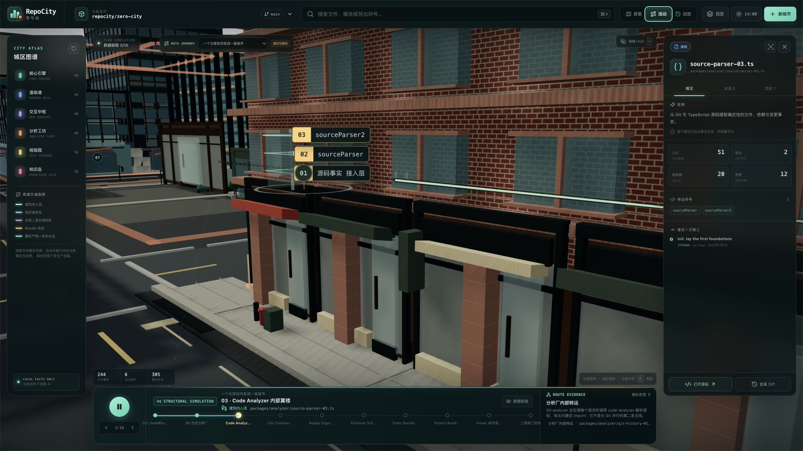
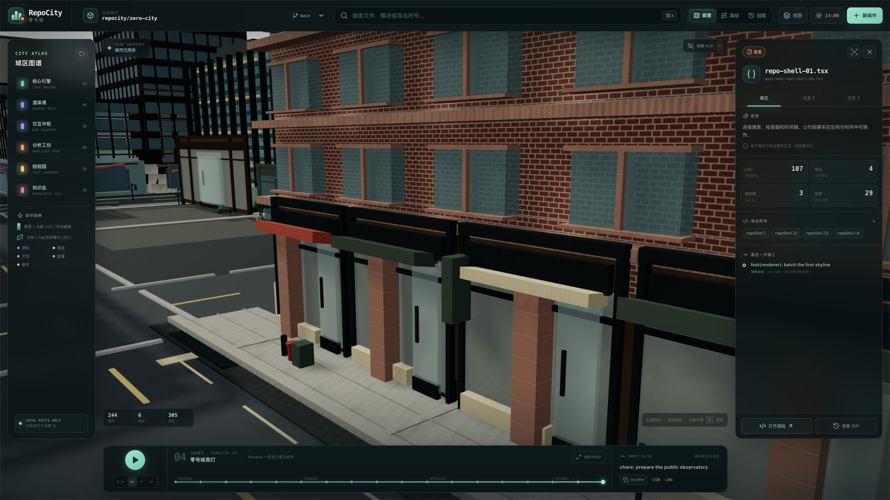
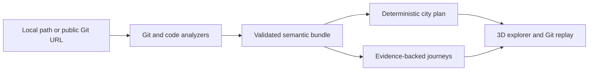

<div align="center">

# RepoCity

**Turn a codebase into an explorable semantic city.**

Navigate components, modules, files, symbols, dependencies, Git history, and evidence-backed journeys through an interactive 3D repository map.

[](https://github.com/ChanTso/repocity/actions/workflows/ci.yml)
[](LICENSE)
[](CHANGELOG.md)

</div>


> [!IMPORTANT]
> RepoCity is an experimental public alpha. Its repository-semantic mapping and evidence-backed journeys are functional; the renderer, supported repository coverage, and semantic zoom remain active prototypes.

## What is RepoCity?

RepoCity is a local-first 3D repository explorer. It translates software structure into a stable urban hierarchy instead of treating every file as an unrelated tower:

```text
repository
└── component / workspace / package
    └── module or file group
        └── file
            └── symbol / export
```

Districts provide component-level context. Buildings stay linked to real repository entities. Roads aggregate static structural relationships. Evidence-backed journeys trace supported paths through the system without presenting decorative city life as runtime telemetry.

## Highlights

- Deterministic spatial addresses for repository entities
- Components distributed across connected districts and blocks
- Building, module-group, file, symbol, and export inspection
- Evidence-backed repository and delivery journeys
- Explore, semantic Map, evidence Flow, and Git-history Replay modes
- River, bridge, street, transit, and asset-backed hero-district context
- Deterministic ambient lanes, sidewalks, crossings, entrances, riverwalks, and boats that remain explicitly non-semantic
- Explicit provenance for inferred and simulated information
- Local analysis that does not execute the target repository

## Evidence-backed journeys



Flow mode turns supported repository relationships into inspectable journeys. Routes identify their provenance and evidence. Reduced ambient vehicles and people remain visible for city scale, but the persistent legend and rendering language identify them as deterministic, non-semantic context rather than telemetry.

Ambient density is a fixed city-presentation budget. It is not derived from repository importance, runtime demand, or production traffic, and pausing Flow evidence does not pause the surrounding city context.

Read [Evidence flows](docs/evidence-flows.md).

## Semantic inspection



Map mode reduces the city context and exposes component ownership, semantic building envelopes, stable addresses, one-hop relations, and a repository-to-symbol breadcrumb. Select a file to inspect its repository facts and the deterministic rules behind “为什么在这里？”.

Read the [Semantic model](docs/semantic-model.md).

## Street-level visual system


The current development candidate extends its original brick, stone, steel, bronze, glass, storefront, street, river-edge, and bridge language across the semantic core through deterministic modular Chicago Kit v2 signatures. Outer context still uses progressively simpler level-of-detail geometry.

Read the [Visual system](docs/visual-system.md) and [Chicago Kit v2 art bible](docs/CHICAGO_KIT_V2.md).

## Quick start

### Prerequisites

- Node.js 22.23.0 or another compatible Node.js 22 release
- npm 10+
- Git 2.40+
- A desktop browser with WebGL 2 support

```bash
git clone https://github.com/ChanTso/repocity.git
cd repocity
npm ci
npm run dev
```

Open the local URL printed by the development server. The bundled demonstration is selected by default; `/?project=tiny` loads the deterministic five-commit fixture.

### Analyze a repository

```bash
npm run repocity -- build ./path/to/repository \
  --out ./public/projects/my-city
```

You can also pass a public Git URL. Open `/?project=my-city` after compilation. Generated data includes repository paths, metrics, relations, Git facts, and optional knowledge Markdown—not complete source files.

### Controls

- Drag to orbit; scroll to zoom; right-drag to pan.
- Click to select; double-click or press `F` to focus the selection.
- Press `Cmd/Ctrl+K` to search and `H` to toggle the HUD.
- Use 探索 / 地图 / 流动 / 回放 to separate city experience, repository ownership, evidence journeys, and Git evolution.
- In Flow or Replay, press `Space` to play/pause; use arrow keys to step through a flow.
- Press `1`–`8` for the street, storefront, river/bridge, glass-facade, city-composition, public-alpha hero, civic, and riverfront-review cameras.

## Validate

```bash
npm run check
```

This runs linting, type checking, workspace and application tests, the production build, and rendered-HTML checks. See [Development](docs/development.md) for individual commands.

## Architecture



The repository graph remains authoritative. Spatial generation arranges facts; it must not fabricate them.

- [Architecture](docs/ARCHITECTURE.md)
- [Data format](docs/DATA_FORMAT.md)
- [Semantic model](docs/semantic-model.md)
- [Evidence flows](docs/evidence-flows.md)
- [Visual system](docs/visual-system.md)
- [Development](docs/development.md)

## Public alpha boundaries

Available now:

- JavaScript and TypeScript repository analysis;
- stable entity identity across add, rename, modify, and delete history;
- deterministic city planning and semantic selection;
- component, building/module-group, file, symbol, and export-oriented inspection;
- inferred and simulated evidence journeys;
- original asset-backed hero district and simplified outer-city LOD;
- desktop Explore, Map, Flow, and Replay experiences.

Known limitations:

- the bundled full-city demo is a deterministic product dataset, while `tiny` is generated from a real fixture repository;
- visual fidelity is intentionally concentrated in the hero district;
- full semantic zoom and broader language coverage are incomplete;
- ambient people, vehicles, storefronts, and street furniture are context, not observed telemetry;
- performance depends on browser, GPU, repository size, and device-pixel ratio;
- the production build currently reports non-blocking bundle-size and route-classification warnings.

## Contributing, security, and license

Contributions are welcome after reading [CONTRIBUTING.md](CONTRIBUTING.md) and the [Code of Conduct](CODE_OF_CONDUCT.md). Report vulnerabilities according to [SECURITY.md](SECURITY.md), not in a public issue.

RepoCity source and original city-kit assets are licensed under [Apache License 2.0](LICENSE). Third-party packages and their licenses remain their authors' property; see [THIRD_PARTY_NOTICES.md](THIRD_PARTY_NOTICES.md) and the [asset manifest](docs/assets/city-kit-v1-manifest.md).

## Status

The current release is **RepoCity v0.1.0-alpha.2 — Public Semantic City Prototype**. The roadmap is intentionally open-ended; no further release cadence is promised. See [CHANGELOG.md](CHANGELOG.md).
