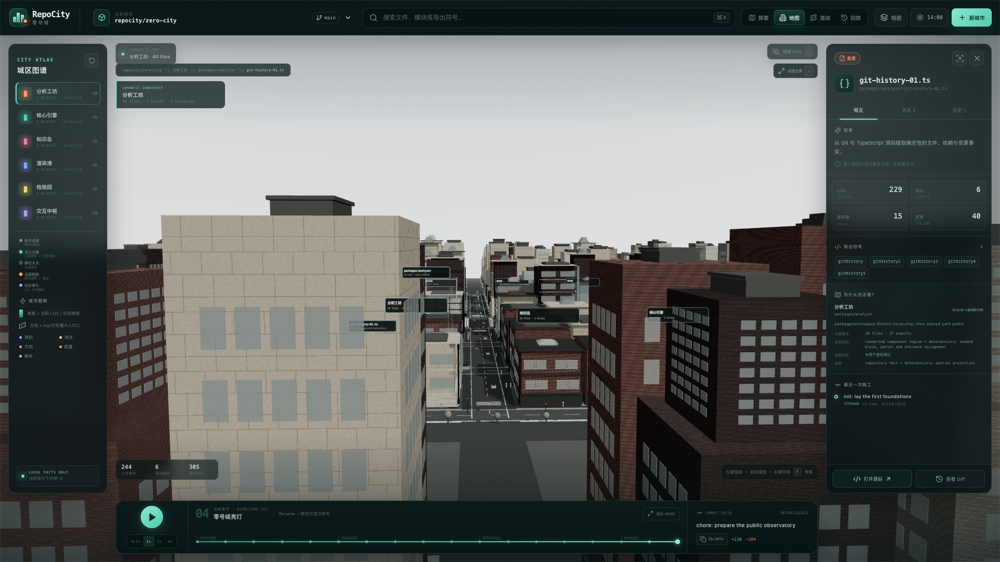
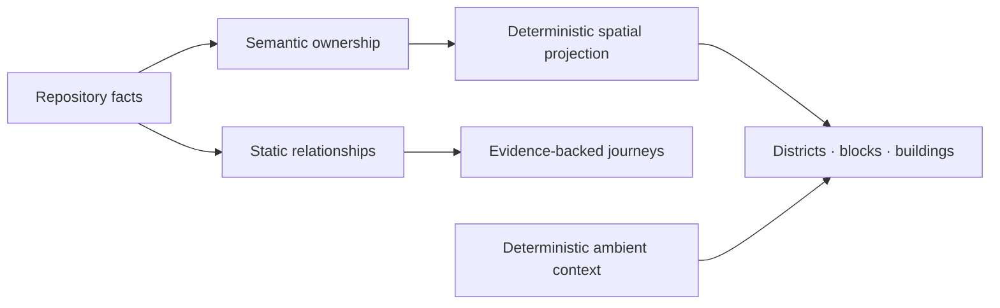
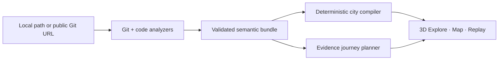

<div align="center">

# RepoCity

**RepoCity turns a codebase into an explorable semantic city.**

Navigate components, modules, files, symbols, dependencies, Git history, and evidence-backed journeys through an interactive 3D repository map.

[](https://github.com/ChanTso/repocity/actions/workflows/ci.yml)
[](LICENSE)
[](https://github.com/ChanTso/repocity/releases)

</div>


> [!IMPORTANT]
> **Experimental showcase release.** Semantic mapping, Map, Flow, Replay, and deterministic city context are functional; visual fidelity and repository coverage remain intentionally bounded.

## What it is

RepoCity is a local-first 3D repository explorer. It projects real repository structure into a stable urban hierarchy:

```text
repository
└── component / workspace / package
    └── module group
        └── file
            └── symbol / export
```

Districts and buildings preserve semantic ownership. Roads summarize static structural relationships. Evidence journeys explain supported paths with visible provenance. Vehicles, pedestrians, boats, storefronts, and city activity provide deterministic context only—they are not runtime traffic or production telemetry.

## See it in motion


Flow keeps the evidence journey visually distinct from the surrounding city. Pausing Flow pauses evidence only; deterministic ambient movement continues independently.

## Why a city

A city makes several repository relationships visible at once: ownership becomes geography, size becomes massing, dependencies become connections, history becomes construction, and a supported explanation becomes a journey through those facts. The metaphor is useful only while the repository graph stays authoritative, so every inferred or simulated layer is labeled rather than presented as measured truth.

## Explore, Map, Flow, Replay

| Mode | What it answers |
| --- | --- |
| **Explore** | What exists, where it lives, and how the repository feels as a whole |
| **Map** | Which component owns each block, building, file, and symbol |
| **Flow** | How an evidence-backed or explicitly simulated journey crosses the system |
| **Replay** | How Git history changed the city while preserving entity identity |




## How meaning maps to the city



The semantic contract is documented in [Semantic model](docs/semantic-model.md) and [Evidence flows](docs/evidence-flows.md). Rendering and ambient context never create repository facts.

## Quick start

Requirements: Node.js 22, npm 10+, Git 2.40+, and a desktop browser with WebGL 2.

```bash
git clone https://github.com/ChanTso/repocity.git
cd repocity
npm ci
npm run dev
```

Open the local URL printed by the development server. The polished deterministic demo city loads directly and requires no GitHub token. `/?project=tiny` opens the small repository fixture.

### Analyze locally

RepoCity has no online GitHub-URL ingestion service. Build a city bundle locally, then open it in the viewer:

```bash
npm run repocity -- build ./path/to/repository \
  --out ./public/projects/my-city
```

Open `/?project=my-city`. The local CLI can also clone a public Git URL into a temporary directory; it does not use a hosted analysis backend or execute the target repository.

### Controls

- Drag to orbit, scroll to zoom, right-drag to pan.
- Click to select; double-click or press `F` to focus.
- Press `Cmd/Ctrl+K` to search and `H` to toggle the HUD.
- Press `Space` to pause Flow evidence or Replay; use arrow keys to step through a Flow.
- Press `1`–`8` for curated street, river, facade, city, civic, and riverfront cameras.

## Validate

```bash
npm run check
```

This runs lint, type checking, workspace and application tests, the production build, and rendered-HTML checks.

## Architecture



- [Architecture](docs/ARCHITECTURE.md)
- [Data format](docs/DATA_FORMAT.md)
- [Semantic model](docs/semantic-model.md)
- [Evidence flows](docs/evidence-flows.md)
- [Visual system](docs/visual-system.md)
- [Chicago Kit v2](docs/CHICAGO_KIT_V2.md)
- [Development](docs/development.md)

## Current scope and limits

- Curated experimental showcase, not a production observability product.
- Local JavaScript and TypeScript repository analysis; language and repository-shape coverage is bounded.
- The full-city demo is a deterministic product dataset; `tiny` is generated from a real fixture repository.
- Chicago-inspired stylized rendering, not a photoreal Chicago digital twin.
- Ambient city life is deterministic non-semantic context, never claimed as measured activity.
- No online GitHub URL ingestion, hosted analysis queue, production telemetry, or performance guarantee across devices.
- The production build has known non-blocking bundle-size and route-classification warnings.
- No future release cadence is promised.

## License

RepoCity source and original City Kit assets are licensed under the [Apache License 2.0](LICENSE). Third-party packages retain their own licenses; see [Third-party notices](THIRD_PARTY_NOTICES.md) and the [City Kit v2 asset manifest](docs/assets/city-kit-v2-manifest.md).

Security reports belong in GitHub private vulnerability reporting; see [SECURITY.md](SECURITY.md). Small, focused contributions can follow [CONTRIBUTING.md](CONTRIBUTING.md) and the [Code of Conduct](CODE_OF_CONDUCT.md).
