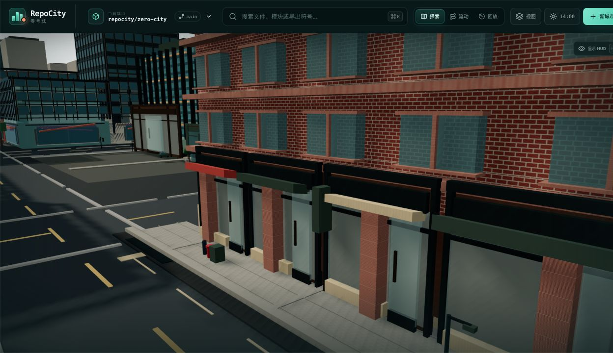
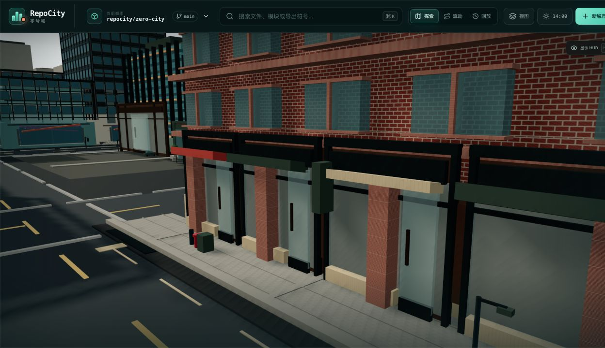
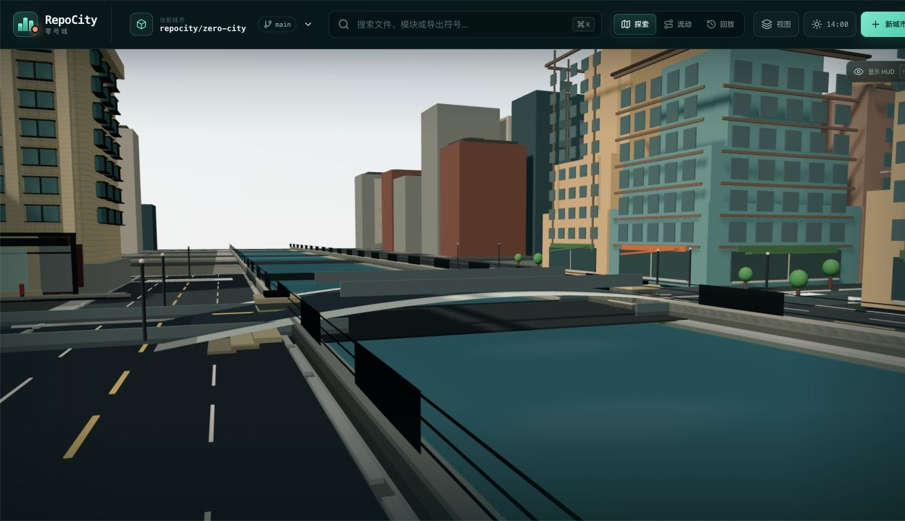
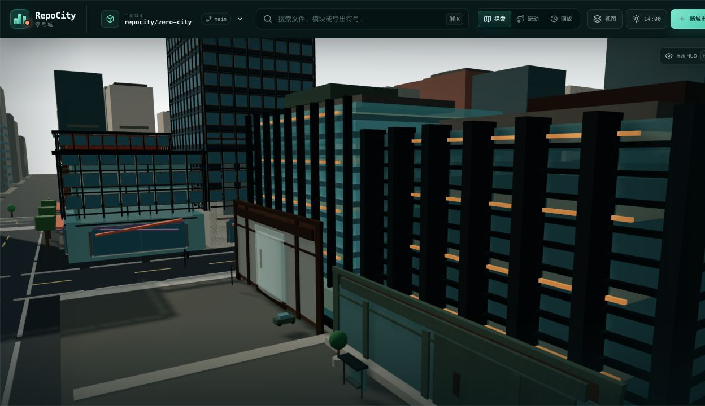
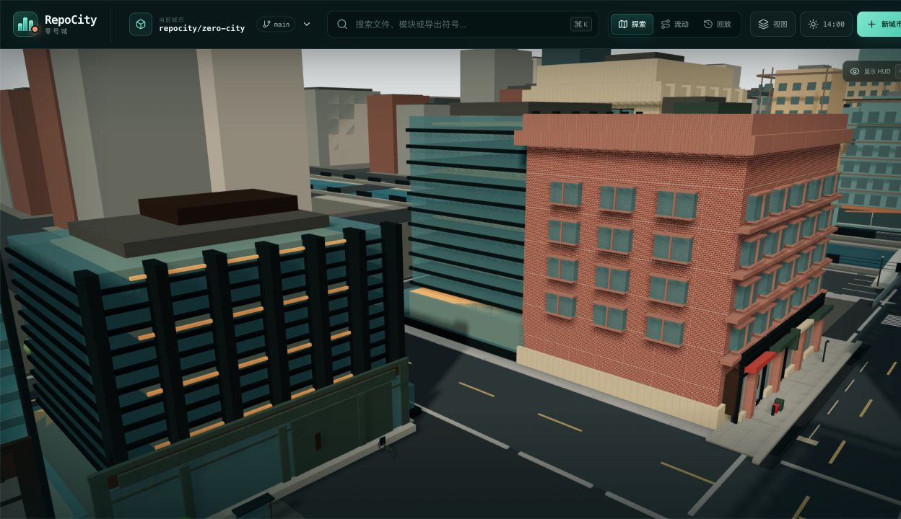

# RepoCity V4.3 — Street Reality Pass

## V4.2 baseline diagnosis

The locked V4.2 baseline proves that asset-backed GLB/PBR rendering and a two-block semantic hero slice are viable, but it is not a visually accepted city. The repeated freestanding masses, flat cyan/black glass, generic ground floors, empty street section and elevated cameras make it read as a tabletop model. Repository topology and entity mappings are useful; visual urban grammar is the failure.

The immutable BEFORE set is in `docs/screenshots/visual-v4-3/before/`. It was captured at 1280×720 with the RepoCity HUD hidden from the five pre-existing V4.2 review bookmarks before source changes.

## Scope and non-goals

V4.3 deepens only the same two adjacent proof blocks plus the immediately visible bridge, river edge and near-context ring. It does not expand the detailed kit, add semantic components, change the road graph, alter file mappings, add ambient animation, begin Semantic Zoom V5, or roll the system out city-wide.

## Semantic and non-semantic boundary

The original semantic graph remains authoritative. Five visual building containers retain their V4.2 semantic building, component and primary entity IDs. Storefronts, shallow interiors, parked vehicles, figures, furniture, sidewalk detail and river-edge detail are explicitly `NON_SEMANTIC_URBAN_CONTEXT`. Programs create no repository entities or evidence. Decorative street assets are raycast-disabled; program fronts deliberately route clicks to their existing owning entity.

## Hero-slice architecture

The deterministic `scripts/generate-city-kit.mjs` source continues to generate repository-owned GLBs and PBR maps. Repeated geometry is merged by material inside named modules. V4.3 adds distinct program roots and batched sidewalk/curb/waterfront roots without creating a React object per window.

## Screenshot review — Round 1: street-level structure

Images: `docs/screenshots/visual-v4-3/round-1/`.

Blunt critique:

- The first storefront camera is physically too close to the brick wall, so it proves texture scale rather than urban use. It is not an acceptance composition.
- The semantic building remains a closed solid shell. Recessed interior cards sit behind that opaque face and are occluded, leaving oversized black sign bands and flat colored panels instead of readable shops.
- The masonry plinth and projected lintels are far too deep after whole-building scaling. They read as chunky toy pieces; the river view is still elevated and the bridge reads as abstract stacked ribbons.

Corrections before Round 2: move program layers just beyond the semantic shell while preserving a shallow visual recess, lower and widen the fixed cameras, reduce plinth/window projection depth, lighten structural steel, and place the river camera at pedestrian-edge height.

## Screenshot review — Round 2: materials and river

Images: `docs/screenshots/visual-v4-3/round-2/`.

Blunt critique:

- Local-axis camera placement is mathematically deterministic but visually wrong: adjacent low-detail masses and a tree fully occlude the storefront frame, while the composition camera collides with a facade. Determinism without a useful view is not a virtue.
- Brick scale and thinner reveals improve, but the close glass view still lets dark structural members dominate the panes. The three systems need to be read in wider context, not as near-clipping geometry.
- The river now has continuous walls, rails and a pedestrian edge, but the water is still too cyan and the bridge guard edges are too pale, so the infrastructure reads as stacked model strips.

Corrections before Round 3: return to the verified open world-space sightlines, retain lower eye heights and moderate perspective, use slate water colors independent of the old teal grade, darken bridge steel, and verify every locked view rather than assuming a transform is usable.

## Storefront and lobby grammar

Eight original, fictional visual programs are available: cafe, restaurant, bookstore/stationery, small market, gallery/studio, office lobby, residential/mixed-use entry and service/loading entry. They use different combinations of recessed shadow plane, framed door, kick plate, transom, sill, canopy/blade sign, shallow display mass and reception/table/crate silhouette. No text or brand is needed for the primary distinction. Ten placements are grouped by five owning buildings and merged by material; each group deliberately routes a click to that existing owner.

## Facade systems

The five hero containers expose four required construction languages: warm brick warehouse, articulated limestone/prewar office, dark expressed-steel modernist frame, and a finer light contemporary curtain wall. Base/middle/top transitions use plinths or podiums, thinner window reveals, string courses/pilasters, cornices/parapets and non-identical roof screens or penthouses.

## Three curtain-wall systems

- Dark-steel modernist: heavier vertical frame, smoked vision zones, horizontal slab rhythm and selective warm interior cards.
- Blue/green office: finer mullions, separately named spandrel material, lighter pane response and lower contrast.
- Transparent podium: larger clear panes, bronze/steel entry frame, shallow warm lobby/reception geometry and reduced depth writing.

All color textures use sRGB; normal/roughness/AO maps use no color space. The renderer retains ACES tone mapping and sRGB output. Glass uses front-side, restrained transparency and environment reflections rather than a transparent pane per office window.

## Masonry and brick materials

Brick and limestone albedo/normal/roughness/AO maps are deterministic 128×128 procedural originals. Brick uses offset courses, visible but restrained mortar, noise-driven hue breakup and a high-roughness response. Limestone uses a wider joint hierarchy and a different roughness family. Geometry supplies the remaining distinction: brick lintel/sill/reveal courses versus stone pilasters, rustication, entablature and crown.

## River and bridge

The water shader now uses dark slate depth and view-angle colors with restrained animated ripple/glint instead of the former flat cyan grade. Continuous river-wall roots add cap stones and denser rail spacing. Bridge abutments add masonry courses, caps and bearing blocks. A low-cost waterfront walk, steps and mooring bollard remain non-semantic. The road bridge keeps the evidence-backed road topology; its guard structure is now dark steel rather than white model-strip geometry.

## Lighting and color management

The visual slice uses a neutral daylight background/fog, warm key and cooler fill, neutral ground bounce, ACES exposure 1.02 and softer contact anchoring. Structural steel was lifted from near-black; water and glass no longer share one saturated teal. No bloom, vignette, depth of field or heavy fog is used to conceal geometry.

## Locked camera presets

V4.3 uses deterministic perspective presets: `street-corner`, `storefront-street`, `river-bridge`, `glass-facade`, and `urban-composition`. Keys 1–5 activate them in that order. Exact tuples are tested from `makeAssetReviewCameraPresets`.

## Near-context LOD

Only ring 1 receives additional side-window bands and varied roof equipment. It stays low-cost and does not become an interactive or semantic replacement.

## Performance

Verified V4.2 baseline at the locked hero view, 1280×720: 116 draw calls, 255,636 triangles, 123 geometries, 33 textures, 33 programs, 8.27 ms median frame time (120.8 FPS reported by the in-app renderer monitor). Runtime DPR and GPU-memory counters were not exposed by the review environment; Canvas was configured for DPR `[1, 1.5]`.

Final same-environment results are recorded after Round 3.

Final locked measurement at the same 1280×720 in-app browser and `urban-composition` preset: 134 draw calls, 271,208 triangles, 144 geometries, 33 textures, 33 programs, 8.24 ms median frame time and 119.3 FPS. Draw calls increased 15.5%, remaining below the explicit 25% ceiling of 145. The program geometry is merged by material per owning semantic building; street-detail LOD is limited to the two street-front buildings and river edge. No facade/storefront geometry is rebuilt in `useFrame`.

GPU memory, runtime hardware model and exact effective DPR remain unavailable in this review environment and are not inferred.

## Screenshot review — Round 3: final composition

Images: `docs/screenshots/visual-v4-3/round-3/`. The identical deliverable set is in `docs/screenshots/visual-v4-3/after/`.

Blunt final self-assessment:

- The storefront frame now presents a continuous frontage with differently proportioned doors, four canopy/sign treatments and a sidewalk/curb section. It is much more legible than V4.2, but the shallow interiors remain pale and do not yet make every program unmistakable to an uninformed viewer.
- Brick, limestone, dark steel and light glass are separable by frame depth and roughness, and the three glass families are visible in the dedicated frame. However, the dark-frame facade is still too graphically dominant and some ring-1/context buildings remain blank slabs.
- The river is continuous and infrastructure is layered, but the bridge deck/guard geometry is still overtly procedural. The urban frame reads as a city faster than V4.2 and has no board edge, yet its mid-distance repetition still prevents a Cities: Skylines/SimCity-quality place illusion.

## Final five-frame review page

| Street corner | Storefront street | River and bridge |
| --- | --- | --- |
|  |  |  |

| Glass facade | Urban composition |
| --- | --- |
|  |  |

The evidence-backed Flow regression is `docs/screenshots/visual-v4-3/flow-regression.png`.

## Automated validation

Focused tests cover deterministic hero assignment, existing semantic IDs, exactly two adjacent proof blocks, all eight visual programs, `NON_SEMANTIC_URBAN_CONTEXT`, deliberate owner routing, four facade languages, three distinct glass configurations, deterministic camera tuples, current asset hashes, portable paths and absence of render-frame asset generation. Existing regression coverage retains component/building selection, inspector paths and the full semantic snapshots for routes 8, 9 and 10.

Final results: `npm run lint`, `npm run typecheck`, `npm run test` (92 app/lib tests plus all workspace tests, production build and two rendered-HTML tests), standalone `npm run build`, standalone `npm run test:web`, `npm run check`, and `git diff --check` all pass. The unchanged build emits the known >500 kB client-chunk and Vinext route-classification warnings.

## Remaining limitations and scale recommendation

Full-city rollout is explicitly not included. Recommendation: **NOT_READY_TO_SCALE**. The asset/data architecture, semantic boundary and batching strategy are ready to retain, but the fixed images still need a further art-direction pass on interior legibility, bridge structure, mid-distance facade variation and less geometric trees before this visual language should multiply across eighteen blocks.
